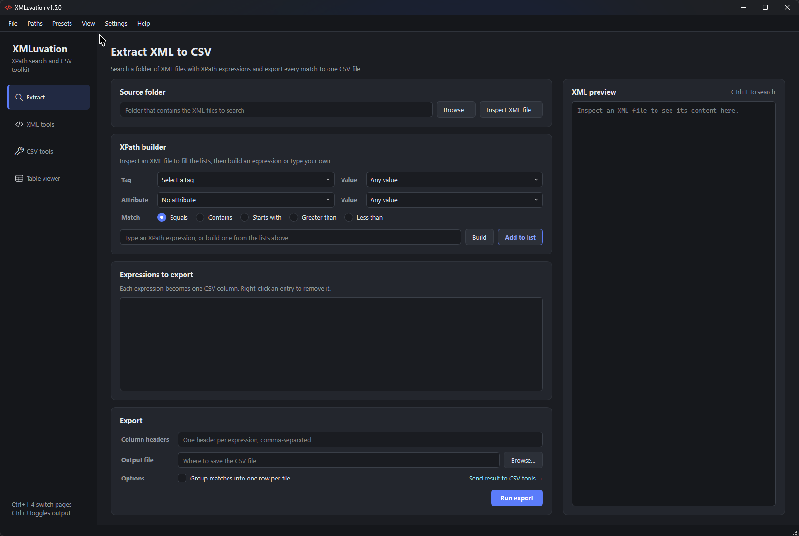
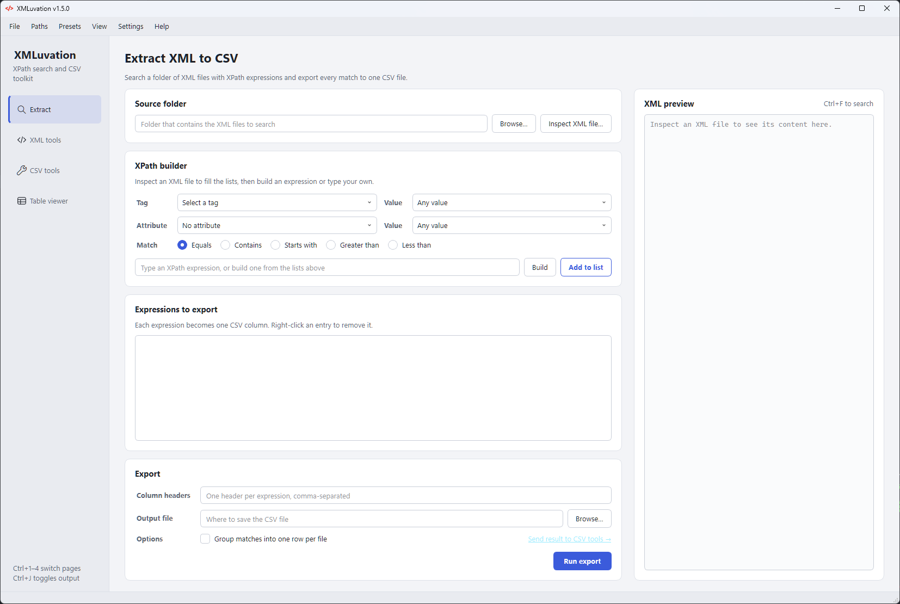

# Screenshots




# Running from source

```powershell
uv sync
uv run python -m xmluvation
```

See [docs/ARCHITECTURE.md](docs/ARCHITECTURE.md) for the project structure, tests and tooling.

# License

[MIT](LICENSE)
